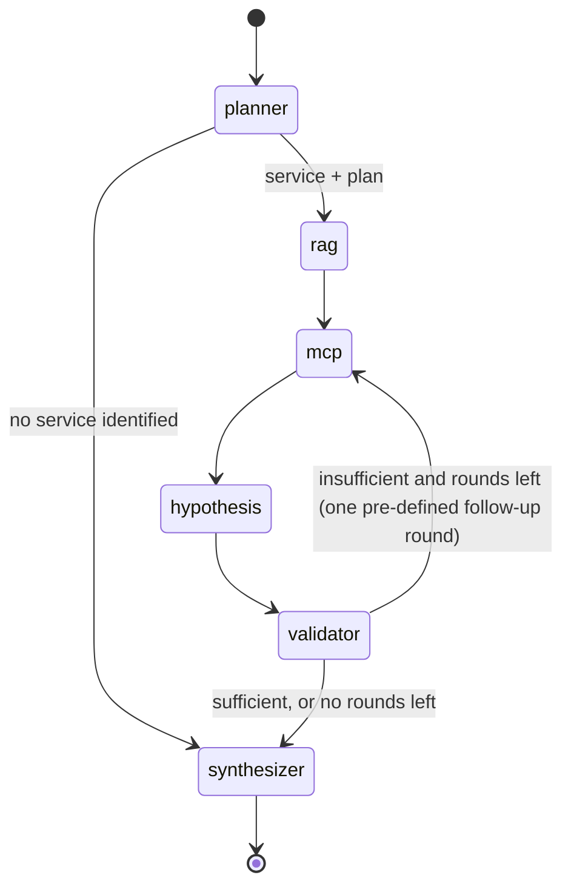

# OpsPilot investigation agent

Code: `apps/api/app/agents/`. The agent is an explicit, bounded LangGraph
state machine (spec sections 10–12 and 41). It combines RAG (runbooks,
architecture notes, postmortems) with MCP (live telemetry) and reports facts,
retrieved evidence, hypotheses, validation and conclusion separately.

## State diagram



## State

`AgentState` (TypedDict), updated by each node:

| Field | Meaning |
|---|---|
| `query`, `service`, `symptoms`, `window_minutes` | the question, the service being investigated, `latency`/`errors`, and the look-back window |
| `plan` | tool calls to make: name plus arguments |
| `tool_results`, `tool_calls` | raw MCP results keyed by call, plus an audit list (status, duration) |
| `retrieved` | knowledge-base passages with citations (`K1`, `K2`, …) |
| `observations` | facts extracted from telemetry (`F1`, `F2`, …) with signal tags |
| `missing` | evidence that could not be obtained, and why |
| `hypotheses` | candidate causes with supporting/contradicting ids and confidence breakdown |
| `iteration`, `next_action` | loop control |
| `trace` | per-node duration and summary (the trace concept from spec section 32) |
| `report` | final `InvestigationReport` |

## Nodes

| Node | What it does |
|---|---|
| **planner** | Identifies the service, detects symptoms and plans the tool calls (see below). If no service is found, it skips straight to the synthesizer. |
| **rag** | Retrieves runbooks and postmortems for the question and for "`<service>` `<symptom>` troubleshooting root cause", filtered to the service. A knowledge-base outage is recorded as missing evidence. |
| **mcp** | Runs the pending planned calls in parallel, through the allow-listed MCP client and within the tool budget. Then extracts observations (`evidence.py`). |
| **hypothesis** | Applies the cause rules to the observations' signal tags (`reasoning.py`). |
| **validator** | Scores each hypothesis (supporting evidence, contradictions, confidence) and ranks them. If no hypothesis is clearly ahead, it schedules one follow-up round. |
| **synthesizer** | Builds the report: conclusion, recommendations, missing evidence. With an LLM configured, it adds a labelled model-written summary. |

### How the planner identifies the service

1. It matches the question against the services that currently export `app_info`. The list comes from MCP `query_metrics`.
2. If metrics are unavailable, it uses the service names attached to knowledge-base documents that match the question.
3. If an LLM is configured, it can pick from those known names. Any answer outside the list is discarded.

### Tool selection

| Question type | Tools called |
|---|---|
| Every investigation | `get_service_health`, `get_incident_events`, `get_recent_deployments`, `get_service_dependencies`, the p95 history (`query_metrics`), and warning-or-worse logs |
| Latency questions (or no clear symptom) | add database query p95 history |
| Error questions (or no clear symptom) | add 5xx ratio history |
| Follow-up round | health of up to 3 dependencies, deployments over 6 h, error logs over a doubled window |

## Evidence extraction

Each tool result becomes zero or more observations, each tagged with signals:

| Signal | When it is set |
|---|---|
| `latency_step` / `error_step` | a sustained step in the latest part of the series. The step must reach 2× (latency) or 3× (errors) the median of the points just before it, and stay above an absolute floor. The *last* elevated run is used, so an earlier recovered incident neither hides the current one nor moves its start time. |
| `db_latency_rise` / `db_latency_flat` | the same step test on database query p95: 3× the baseline and at least 0.3 s |
| `db_slow_logs`, `dependency_errors`, `internal_errors` | at least 3 matching log events (`slow_query_detected`, `dependency_*`, `request_processing_failed`) |
| `deploy_recent` | a version first observed inside the window. Each one records the version it replaced. |
| `symptom_latency`, `symptom_errors` | p95 above 1 s or 5xx ratio above 5% (both configurable) |
| `alert_firing` | a firing or pending alert for the service |
| `dependency_degraded`, `dependencies_healthy` | from the service's own health result or the follow-up dependency checks |

A tool that returns `unavailable` produces no facts, only a missing-evidence note.

## Hypotheses

| Cause | Applies when | Contradicted by |
|---|---|---|
| `deployment_db_regression` | a recent release, plus a DB latency rise or slow-query logs | DB latency flat; release after the onset |
| `deployment_regression` | a recent release plus a confirmed symptom | a degraded dependency; release after the onset |
| `database_degradation` | DB latency rise or slow-query logs | DB latency flat |
| `dependency_failure` | a degraded dependency or dependency-failure logs | all dependencies healthy |
| `application_errors` | `request_processing_failed` logs | dependency errors or a degraded dependency |

`deployment_db_regression` subsumes `database_degradation` and
`deployment_regression`: they are not counted as competing explanations when
deciding whether the evidence is sufficient.

## Confidence

Confidence is a documented heuristic, not a calibrated probability:

```
raw = base 0.10 (symptom confirmed)
    + temporal   0.25  cause precedes the symptom onset by 0–30 min (±2 min tolerance)
    + metric     0.25  a metric moved as the cause predicts
    + log        0.20  logs show the mechanism
    + deployment 0.10  a release is in the window (deployment causes only)
    + knowledge  0.10  a retrieved, unflagged passage matches the cause
    − 0.25 per contradiction
confidence = clamp(raw, 0, 0.95) × (0.6 + 0.4 × coverage)
```

- **Coverage:** the share of planned sources that answered (MCP tools plus the knowledge base). Missing telemetry lowers confidence instead of being ignored.
- **Ceiling:** confidence never goes above 0.95.
- **Time tolerance:** deploy and onset times are only accurate to about a minute (first scrape of the new version, 1-minute rate window). A release up to 2 minutes "after" the onset counts as coincident.
- **Prompt-injection guard:** passages flagged as possible prompt injection never add knowledge confidence.

### Decision thresholds

| Threshold | Value | Effect |
|---|---|---|
| Sufficient evidence | best ≥ 0.6 and ≥ 0.15 ahead of the next non-subsumed rival | stop gathering evidence |
| Reportable | ≥ 0.25 | below this, no root cause is claimed |
| Tentative | < 0.5 | the conclusion is labelled "Tentative root cause (low confidence; key evidence is missing)" |

## Failure handling

- **MCP server unreachable:** every call returns `unavailable`. The report lists the missing evidence and claims no root cause it cannot support.
- **One backend down** (Prometheus, Loki or the knowledge base): the agent continues with the remaining evidence. Coverage drops, and so does confidence.
- **LLM unavailable or not configured:** the result is unchanged. `llm.status` is `unavailable` or `not_used`.
- **Unknown service:** the agent stops after planning and asks for the service name.

## Termination limits

| Limit | Default | Setting |
|---|---|---|
| LangGraph recursion limit | 15 steps | `AGENT_MAX_STEPS` |
| Evidence rounds | 2 | `AGENT_MAX_ITERATIONS` |
| Tool calls per investigation | 16 | `AGENT_MAX_TOOL_CALLS` |
| Wall-clock timeout | 120 s | `AGENT_TIMEOUT_SECONDS` |

## Why a bounded graph instead of an autonomous agent

- **Predictable cost and latency:** the number of steps and tool calls is capped by design.
- **Auditable:** every conclusion points at observation and evidence ids, and the trace shows each step.
- **Safe:** the agent never chooses arbitrary tools or actions. It can only call six read-only tools, and remediation is a recommendation that needs human approval.
- **Testable:** with simulated tools the graph is deterministic. 14 evaluation scenarios run in CI-like conditions in about a second.

An open-ended "think, call any tool, repeat" loop would make all four properties
probabilistic.

## Evaluation

`apps/api/app/agents/scenarios/cases.json` holds 14 scenarios:

- release + DB regression
- DB-only slowness
- dependency failures
- release-induced errors
- application errors
- an old release
- a release after the onset
- a healthy service
- an unknown service
- Loki down
- Prometheus down
- a timeout cascade
- the knowledge base down
- poisoned knowledge

Run them with `pytest -m evaluation` or `python -m app.agents.evaluation`. Results are written to `tests/evaluation/results/latest.json`.

**Caveat:** the scenarios were written together with the rules, so a perfect score shows the rules do what they claim. It does not show how well they generalise to unseen incidents.
